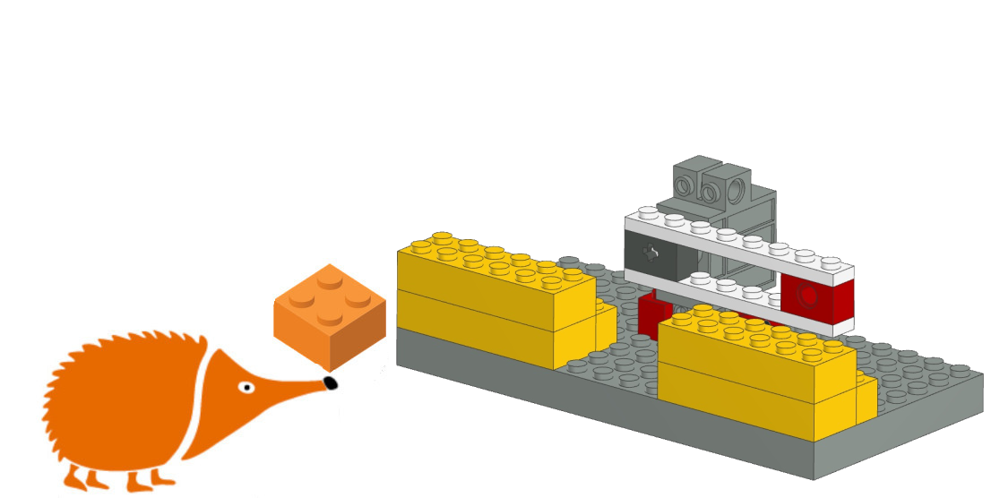
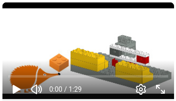
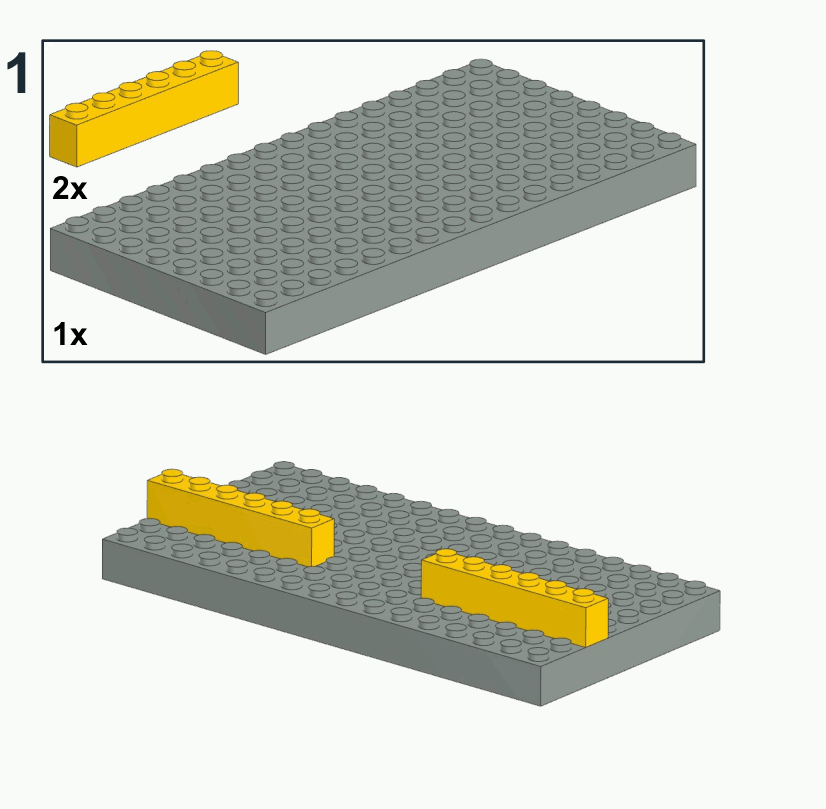
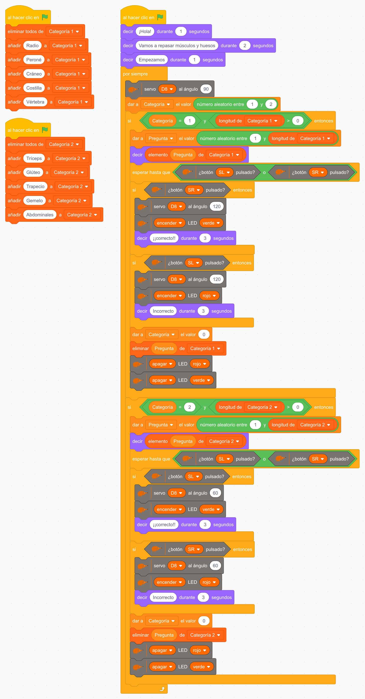

# Preguntas de 2 categorías

Juego de preguntas con bloques de construcción y la placa EchidnaBlack2 para clasificar palabras en dos categorías. En este ejemplo repasamos el cuerpo humano: cada palabra que aparece en pantalla es un hueso o un músculo, y hay que decidir a qué grupo pertenece pulsando uno de los dos botones de la placa.

El servomotor conectado a D8 mueve un indicador que señala la categoría correcta después de cada respuesta, y los LEDs de la placa nos dicen si hemos acertado (verde) o fallado (rojo). Las listas se pueden cambiar fácilmente en el programa, así que el mismo modelo sirve para repasar cualquier tema que se pueda dividir en dos categorías.

## Vídeo

## Guía de montaje

[Instrucciones en PDF](Preguntas2C.pdf)

## Proyecto en EchidnaML

[Descarga el archivo .sb3 para EchidnaML](Preguntas2C.sb3)

## Cómo funciona el programa

### Las listas de preguntas

El programa usa dos listas:

* **Categoría 1** (huesos): Radio, Peroné, Cráneo, Costilla y Vértebra.
* **Categoría 2** (músculos): Tríceps, Glúteo, Trapecio, Gemelo y Abdominales.

Al pulsar la bandera verde, dos scripts vacían las listas y las vuelven a llenar, así cada partida empieza con todas las palabras.

### El bucle principal

El tercer script saluda ("¡Hola!", "Vamos a repasar músculos y huesos", "Empezamos") y entra en un bucle "por siempre" que repite estos pasos:

1. Coloca el servomotor a 90º, la posición central de reposo.
2. Elige al azar la categoría de la siguiente pregunta (1 o 2) y la guarda en la variable `Categoría`.
3. Si la lista de esa categoría todavía tiene palabras, elige una posición al azar, la guarda en la variable `Pregunta` y el personaje dice la palabra que hay en esa posición.
4. Espera hasta que se pulse el botón SL o el botón SR de la placa.
5. Comprueba la respuesta:
   * Si la palabra es un hueso, la respuesta correcta es SR. El servomotor gira a 120º para señalar los huesos.
   * Si la palabra es un músculo, la respuesta correcta es SL. El servomotor gira a 60º para señalar los músculos.
   * Si se ha pulsado el botón correcto, se enciende el LED verde y el personaje dice "¡¡correcto!!". Si no, se enciende el LED rojo y dice "Incorrecto". El mensaje se muestra durante 3 segundos.
6. Pone `Categoría` a 0, borra de la lista la palabra preguntada para que no se repita y apaga los dos LEDs.

El servomotor siempre señala la categoría correcta, tanto si hemos acertado como si no, así que también sirve para aprender de los errores.

Cuando a una lista ya no le quedan palabras, el programa deja de preguntar de esa categoría y sigue solo con la otra. Cuando se vacían las dos, el juego termina y el indicador se queda en el centro. Para volver a jugar, basta con pulsar otra vez la bandera verde.

### Cómo adaptarlo a otros temas

Para repasar otro tema, solo hay que cambiar las palabras de los dos primeros scripts. Por ejemplo: animales vertebrados e invertebrados, sustantivos y verbos, o números pares e impares. Se pueden añadir o quitar palabras sin tocar el bucle principal, porque las preguntas se eligen según la longitud de cada lista.
